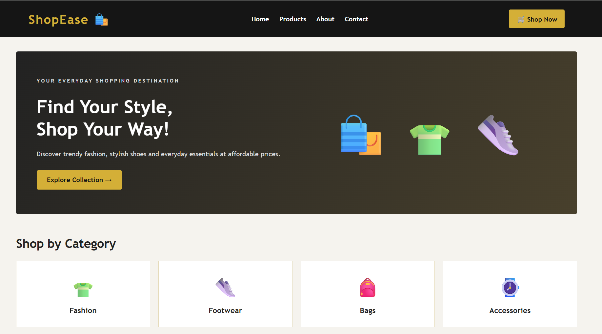
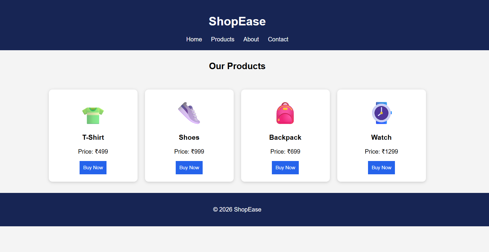
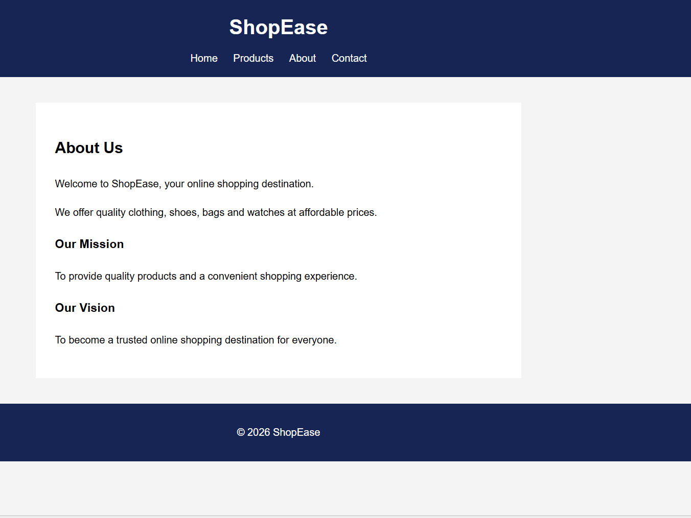
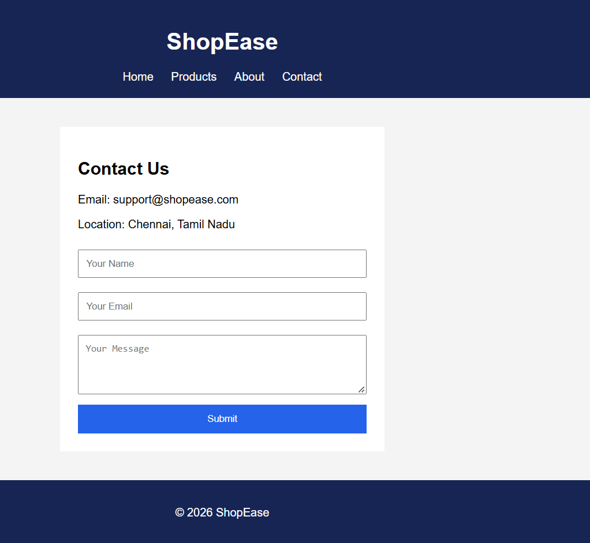

# Ex02 Commercial Website
## Date:02.11.2026

## AIM
To create a commercial website using CSS Flexbox.

## ALGORITHM
### STEP 1
Create an HTML file (index.html)

### STEP 2
Create a CSS file (style.css)

### STEP 3
Include a navigation bar with links to different sections.

### STEP 4
Add structured sections for Homepage, Products / Services, About Us, Contact Details and User Account.

### STEP 5
Include social media links at the footer with copyright information.

### STEP 6
Define global styles for fonts, colors, and layout.

### STEP 7
Style the header, navigation bar, and sections.

### STEP 8
Use Flexbox for layout design.

### STEP 9
Add hover effects and transitions for interactivity.

### STEP 10
Add Images and Media.

### STEP 11
Use optimized images for a professional look.

### STEP 12
Open the HTML file in a browser to check layout and functionality.

### STEP 13
Fix styling issues and refine content placement.

### STEP 14
Deploy the website.

### STEP 15
Upload to GitHub Pages for free hosting.

## PROGRAM
```
<!-- index.html -->

<!DOCTYPE html>
<html lang="en">
<head>
    <meta charset="UTF-8">
    <meta name="viewport" content="width=device-width, initial-scale=1.0">
    <title>ShopEase - Online Store</title>
    <link rel="stylesheet" href="style.css">
</head>
<body>

    <header>
        <h1 class="logo">ShopEase 🛍️</h1>

        <nav>
            <a href="index.html">Home</a>
            <a href="products.html">Products</a>
            <a href="about.html">About</a>
            <a href="contact.html">Contact</a>
        </nav>

        <a href="products.html" class="cart">🛒 Shop Now</a>
    </header>

    <section class="hero" id="home">
        <div class="hero-text">
            <p class="tagline">YOUR EVERYDAY SHOPPING DESTINATION</p>
            <h2>Find Your Style,<br>Shop Your Way!</h2>
            <p>Discover trendy fashion, stylish shoes and everyday
               essentials at affordable prices.</p>
            <a href="products.html" class="btn">Explore Collection →</a>
        </div>

        <div class="hero-image">
            🛍️ 👕 👟
        </div>
    </section>

    <section class="section">
        <h2>Shop by Category</h2>

        <div class="categories">
            <div class="category">
                <span>👕</span>
                <h3>Fashion</h3>
            </div>

            <div class="category">
                <span>👟</span>
                <h3>Footwear</h3>
            </div>

            <div class="category">
                <span>🎒</span>
                <h3>Bags</h3>
            </div>

            <div class="category">
                <span>⌚</span>
                <h3>Accessories</h3>
            </div>
        </div>
    </section>

    <section class="section" id="products">
        <div class="section-heading">
            <h2>Featured Products</h2>
            <a href="products.html">View All →</a>
        </div>

        <div class="products">

            <div class="product">
                <div class="product-image">👕</div>
                <h3>Classic T-Shirt</h3>
                <p>Comfortable everyday wear</p>
                <h3 class="price">₹499</h3>
                <button onclick="buy('Classic T-Shirt')">Buy Now</button>
            </div>

            <div class="product">
                <div class="product-image">👟</div>
                <h3>Sport Shoes</h3>
                <p>Style meets comfort</p>
                <h3 class="price">₹999</h3>
                <button onclick="buy('Sport Shoes')">Buy Now</button>
            </div>

            <div class="product">
                <div class="product-image">🎒</div>
                <h3>Travel Backpack</h3>
                <p>Perfect for everyday use</p>
                <h3 class="price">₹699</h3>
                <button onclick="buy('Travel Backpack')">Buy Now</button>
            </div>

            <div class="product">
                <div class="product-image">⌚</div>
                <h3>Classic Watch</h3>
                <p>Complete your look</p>
                <h3 class="price">₹1299</h3>
                <button onclick="buy('Classic Watch')">Buy Now</button>
            </div>

        </div>
    </section>

    <section class="offer">
        <h2>Discover Something You Love!</h2>
        <p>Explore our latest collection and find your favourite products.</p>
        <a href="products.html" class="btn">Shop Collection</a>
    </section>

    <footer>
        <h2>ShopEase</h2>
        <p>Your everyday shopping destination.</p>

        <div class="footer-links">
            <a href="index.html">Home</a>
            <a href="products.html">Products</a>
            <a href="about.html">About</a>
            <a href="contact.html">Contact</a>
        </div>

        <p>Contact: support@shopease.com</p>
        <p>© 2026 ShopEase. All rights reserved.</p>
    </footer>

    <script>
        function buy(product) {
            alert("You selected: " + product);
        }
    </script>

</body>
</html>
<!-- style.css -->

* {
    margin: 0;
    padding: 0;
    box-sizing: border-box;
}

body {
    font-family: Arial, sans-serif;
    background: #f8fafc;
    color: #172554;
}

/* Header and Navigation */
header {
    background: white;
    padding: 20px 7%;
    display: flex;
    justify-content: space-between;
    align-items: center;
    flex-wrap: wrap;
    gap: 20px;
    box-shadow: 0 2px 10px #e2e8f0;
}

.logo {
    color: #2563eb;
    font-size: 27px;
}

nav {
    display: flex;
    gap: 20px;
    flex-wrap: wrap;
}

nav a {
    text-decoration: none;
    color: #172554;
    font-weight: bold;
}

nav a:hover {
    color: #2563eb;
}

.cart {
    background: #dbeafe;
    padding: 12px 16px;
    color: #1d4ed8;
    text-decoration: none;
    border-radius: 8px;
}

/* Hero Section */
.hero {
    width: 86%;
    margin: 35px auto;
    padding: 50px;
    min-height: 330px;
    background: linear-gradient(120deg, #dbeafe, #eff6ff);
    border-radius: 20px;
    display: flex;
    justify-content: space-between;
    align-items: center;
    flex-wrap: wrap;
    gap: 30px;
}

.hero-text {
    flex: 1;
    min-width: 250px;
}

.tagline {
    color: #2563eb;
    font-size: 12px;
    font-weight: bold;
    letter-spacing: 1px;
    margin-bottom: 15px;
}

.hero-text h2 {
    font-size: 42px;
    line-height: 1.2;
    margin-bottom: 18px;
}

.hero-text p {
    color: #475569;
    line-height: 1.7;
    margin-bottom: 22px;
}

.hero-image {
    flex: 1;
    min-width: 200px;
    text-align: center;
    font-size: 90px;
}

/* Buttons */
.btn {
    display: inline-block;
    background: #2563eb;
    color: white;
    text-decoration: none;
    padding: 13px 20px;
    border-radius: 7px;
    font-weight: bold;
}

.btn:hover,
button:hover {
    background: #1d4ed8;
}

/* Common Section */
.section {
    width: 86%;
    margin: 50px auto;
}

.section > h2,
.section-heading h2 {
    font-size: 28px;
    margin-bottom: 25px;
}

.section-heading {
    display: flex;
    justify-content: space-between;
    align-items: center;
    flex-wrap: wrap;
}

.section-heading a {
    text-decoration: none;
    color: #2563eb;
}

/* Category Cards - Flexbox */
.categories {
    display: flex;
    justify-content: space-between;
    gap: 20px;
    flex-wrap: wrap;
}

.category {
    background: white;
    flex: 1;
    min-width: 130px;
    padding: 25px 15px;
    text-align: center;
    border-radius: 12px;
    box-shadow: 0 2px 8px #e2e8f0;
    transition: transform 0.3s;
}

.category:hover {
    transform: translateY(-5px);
}

.category span {
    font-size: 45px;
}

.category h3 {
    margin-top: 12px;
}

/* Product Cards - Flexbox */
.products {
    display: flex;
    justify-content: center;
    flex-wrap: wrap;
    gap: 22px;
}

.product {
    background: white;
    flex: 1 1 200px;
    max-width: 280px;
    padding: 20px;
    text-align: center;
    border-radius: 12px;
    box-shadow: 0 2px 8px #e2e8f0;
    transition: transform 0.3s;
}

.product:hover {
    transform: translateY(-5px);
}

.product-image {
    background: #eff6ff;
    padding: 20px;
    border-radius: 10px;
    font-size: 65px;
    margin-bottom: 18px;
}

.product h3 {
    margin-bottom: 10px;
}

.product p {
    color: #64748b;
    font-size: 14px;
}

.price {
    color: #2563eb;
    margin: 15px 0;
}

button {
    width: 100%;
    padding: 12px;
    background: #172554;
    color: white;
    border: none;
    border-radius: 7px;
    cursor: pointer;
}

/* Offer Section */
.offer {
    width: 86%;
    margin: 50px auto;
    padding: 40px 20px;
    text-align: center;
    background: #172554;
    color: white;
    border-radius: 15px;
}

.offer p {
    margin: 15px 0 25px;
    color: #dbeafe;
}

/* Footer */
footer {
    background: #172554;
    color: white;
    text-align: center;
    padding: 35px 20px;
    line-height: 2;
}

.footer-links {
    margin: 12px 0;
}

.footer-links a {
    color: #bfdbfe;
    text-decoration: none;
    margin: 0 10px;
}

/* Mobile Responsive */
@media (max-width: 600px) {
    header {
        justify-content: center;
    }

    nav {
        justify-content: center;
        gap: 14px;
    }

    .hero {
        padding: 30px 20px;
    }

    .hero-text h2 {
        font-size: 32px;
    }

    .hero-image {
        font-size: 65px;
    }

    .section > h2,
    .section-heading h2 {
        font-size: 23px;
    }
}


<!--products.html -->

<!DOCTYPE html>
<html>
<head>
    <title>ShopEase - Products</title>
    <style>
        body {
            font-family: Arial, sans-serif;
            margin: 0;
            background: #f4f4f4;
        }
        header, footer {
            background: #172554;
            color: white;
            padding: 20px;
            text-align: center;
        }
        nav { margin-top: 15px; }
        nav a {
            color: white;
            text-decoration: none;
            margin: 10px;
        }
        h2 { text-align: center; margin-top: 30px; }
        .products {
            display: flex;
            justify-content: center;
            flex-wrap: wrap;
            gap: 20px;
            padding: 30px;
        }
        .product {
            background: white;
            width: 200px;
            padding: 20px;
            text-align: center;
            border-radius: 10px;
            box-shadow: 0 2px 8px #ccc;
        }
        .emoji { font-size: 60px; }
        button {
            background: #2563eb;
            color: white;
            border: none;
            padding: 10px;
            cursor: pointer;
        }
    </style>
</head>
<body>
<header>
    <h1>ShopEase</h1>
    <nav>
        <a href="index.html">Home</a>
        <a href="products.html">Products</a>
        <a href="about.html">About</a>
        <a href="contact.html">Contact</a>
    </nav>
</header>

<h2>Our Products</h2>

<section class="products">
    <div class="product">
        <div class="emoji">👕</div>
        <h3>T-Shirt</h3>
        <p>Price: ₹499</p>
        <button onclick="buy('T-Shirt')">Buy Now</button>
    </div>
    <div class="product">
        <div class="emoji">👟</div>
        <h3>Shoes</h3>
        <p>Price: ₹999</p>
        <button onclick="buy('Shoes')">Buy Now</button>
    </div>
    <div class="product">
        <div class="emoji">🎒</div>
        <h3>Backpack</h3>
        <p>Price: ₹699</p>
        <button onclick="buy('Backpack')">Buy Now</button>
    </div>
    <div class="product">
        <div class="emoji">⌚</div>
        <h3>Watch</h3>
        <p>Price: ₹1299</p>
        <button onclick="buy('Watch')">Buy Now</button>
    </div>
</section>

<footer>
    <p>© 2026 ShopEase</p>
</footer>

<script>
    function buy(product) {
        alert("You selected: " + product);
    }
</script>
</body>
</html>
<!--about.html -->
<!DOCTYPE html>
<html>
<head>
    <title>About ShopEase</title>
    <style>
        body { font-family: Arial; margin: 0; background: #f4f4f4; }
        header, footer {
            background: #172554; color: white;
            padding: 20px; text-align: center;
        }
        nav { margin-top: 15px; }
        nav a { color: white; margin: 10px; text-decoration: none; }
        main {
            background: white; max-width: 700px;
            margin: 40px auto; padding: 30px; line-height: 1.8;
        }
    </style>
</head>
<body>
<header>
    <h1>ShopEase</h1>
    <nav>
        <a href="index.html">Home</a>
        <a href="products.html">Products</a>
        <a href="about.html">About</a>
        <a href="contact.html">Contact</a>
    </nav>
</header>

<main>
    <h2>About Us</h2>
    <p>Welcome to ShopEase, your online shopping destination.</p>
    <p>We offer quality clothing, shoes, bags and watches at affordable prices.</p>
    <h3>Our Mission</h3>
    <p>To provide quality products and a convenient shopping experience.</p>
    <h3>Our Vision</h3>
    <p>To become a trusted online shopping destination for everyone.</p>
</main>

<footer><p>© 2026 ShopEase</p></footer>
</body>
</html>
<!-- contact.html -->
<!DOCTYPE html>
<html>
<head>
    <title>Contact ShopEase</title>
    <style>
        body { font-family: Arial; margin: 0; background: #f4f4f4; }
        header, footer {
            background: #172554; color: white;
            padding: 20px; text-align: center;
        }
        nav { margin-top: 15px; }
        nav a { color: white; margin: 10px; text-decoration: none; }
        .contact {
            background: white; max-width: 400px;
            margin: 40px auto; padding: 25px;
        }
        input, textarea {
            width: 100%; padding: 10px;
            margin: 10px 0; box-sizing: border-box;
        }
        button {
            width: 100%; padding: 12px;
            background: #2563eb; color: white; border: none;
        }
    </style>
</head>
<body>
<header>
    <h1>ShopEase</h1>
    <nav>
        <a href="index.html">Home</a>
        <a href="products.html">Products</a>
        <a href="about.html">About</a>
        <a href="contact.html">Contact</a>
    </nav>
</header>

<div class="contact">
    <h2>Contact Us</h2>
    <p>Email: support@shopease.com</p>
    <p>Location: Chennai, Tamil Nadu</p>

    <form onsubmit="event.preventDefault(); alert('Thank you for contacting us!')">
        <input type="text" placeholder="Your Name" required>
        <input type="email" placeholder="Your Email" required>
        <textarea rows="4" placeholder="Your Message" required></textarea>
        <button type="submit">Submit</button>
    </form>
</div>

<footer><p>© 2026 ShopEase</p></footer>
</body>
</html>
```

## OUTPUT





## RESULT
The program for creating commercial website using CSS Flexbox is executed successfully.
